> **Note:** This project is a heavily modified fork/derivative of [spinningbanana's original project](链接). The core logic for handling binary data was inspired by the upstream project. 

# DVD-VR Splitter 2

按 DVD-VR 光盘 **IFO 里的节目表**，把 `VR_MOVIE.VRO` 无损拆成一个个 `.mpg`。
是 [spinningbanana/dvd-rtr-vmg0-splitter](https://github.com/spinningbanana/dvd-rtr-vmg0-splitter) 的重写版。

- 版本：**2.1.4**
- 语言：**中文 / 日本語 / English**（界面右上角切换，选择会记住）
- 许可：GPL-3.0（沿用原项目）
- 依赖：Python 3.9+；GUI 需 PySide6；`--remux` 需 ffmpeg
- 实测盘片：**日立 Hitachi DZ-GX20**（DVD-RAM，VR 模式）—— 2 个节目、66.6 MB、92.59 秒

---

## 一、原版错在哪

| 偏移 | 原版认为 | 实际含义 |
|---|---|---|
| `0x100` | “片段表起点” | `pgit_sa` —— **节目表**（Program Information Table） |
| `0x104` | “片段表终点” | 同一区域的结束指针 |
| `0x130` | “标题表” | `def_psi_sa` —— 默认节目集信息（标题文字） |

它再用 `0x6540 / 0x32A0` 两字节“标记”在节目表里逐条扫描猜片段。
在日立 DZ-GX20 的盘上，扫出来的是播放列表里的地址和日期，于是：

```
一张 2 个节目的盘 → 被当成 31 个片段
输出 30 个文件：27 个 0 字节、1 个 1 帧、1 个 11 帧、1 个整片
ffmpeg 还在第 20 段报错：Invalid duration for option t: 1.111e-05
```

## 二、正确结构（本程序的解析依据）

```
0x000  "DVD_RTR_VMG0"
0x100  pgit_sa  → pgiti{ zero(2), nr_of_pgi(1), nr_of_vob_formats(1), pgit_ea(4) }
                  vob_format_t × nr_of_vob_formats（每个 60 字节）
                  pgi_gi{ nr_of_programs(2) }
                  vvobi_sa[program]（4 字节，相对 pgit_sa）
0x130  def_psi_sa → 标题文字

vvob_t（21 字节）: attr(2) 录制时间(5) data1(1) format_id(1) s_ptm(4+2) e_ptm(4+2)
  其后: (attr & 0x80 ? adj_vob(12) : 0) + 2
        vobu_map{ n_time(2), n_vobu(2), time_off(2), vob_off(4，单位扇区) }
        time_info × n_time（7 字节）
        vobu_info × n_vobu（3 字节，后 14 位是扇区数）
```

每个节目在 VRO 里是**连续字节区间**：

```
起点 = vob_off × 2048
长度 = Σ(vobu_size) × 2048
```

直接拷贝 —— 不重编码、不需要 ffmpeg、切点精确到 VOBU。

## 三、实测（Hitachi DZ-GX20 盘镜像）

| 节目 | 录制时间 | 时长 | 大小 | VRO 偏移 | 导出后帧数 |
|---|---|---|---|---|---|
| #1 | 2026-11-11 17:36:20 | 00:01:02.562 | 45.0 MB | 0 | 1875 ✓ |
| #2 | 2026-11-11 17:50:32 | 00:00:30.030 | 21.6 MB | 47,228,928 | 900 ✓ |

- 合计 66.6 MB / 92.59 秒 = 2775 帧，与整盘解码一致
- 导出字节数完全吻合，节目 2 的起点正好等于节目 1 的终点
- ffprobe 校验：mpeg2video + ac3，704×480，29.97 fps

## 四、用法

### 图形界面

双击桌面「DVD-VR 分割器」→ 右上角选语言 → 选 `DVD_RTAV` 目录 → 读取光盘信息
→ 勾选节目 → 开始导出。

输出文件按 **IFO 里的录制日期时间**命名：`2026-11-11_17-36-20.mpg`；
没有录制时间时退回 `program_01.mpg`；同名自动加 `_2`。

### 命令行

```bat
:: 列出节目（可加 --lang zh|ja|en）
python dvdvr_split.py --ifo G:\DVD_RTAV\VR_MANGR.IFO --vro G:\DVD_RTAV\VR_MOVIE.VRO --list

:: 导出全部 / 指定节目 / 重封装
python dvdvr_split.py --ifo ... --vro ... -o D:\out
python dvdvr_split.py --ifo ... --vro ... -o D:\out --programs 2 --remux --lang ja
```

退出码：0 成功，2 解析/导出错误（原因打印到 stderr），130 取消。

## 五、2.1.0 相对 2.0.0

| 项目 | 2.0.0 | 2.1.0 |
|---|---|---|
| 界面语言 | 仅中文 | **中文 / 日本語 / English**，可切换并记住（`%APPDATA%\DVDVRSplitter\config.json`） |
| 命令行语言 | — | `--lang zh\|ja\|en`，也可用环境变量 `DVDVR_LANG` |
| 文件名 | `01_2026-11-11_17-36-20.mpg` | **`2026-11-11_17-36-20.mpg`**（直接用 IFO 的录制日期时间） |
| 重名处理 | 无 | 自动追加 `_2`、`_3` |
| 系统语言识别 | 无 | Windows 用 `GetUserDefaultUILanguage`，其它平台看 `LANG` |

### 2.1.1 修复（2026-11-12）

- **输出目录不可写时给出可读提示**：以前在光盘 / 虚拟光驱上点“开始导出”会弹一大段
  `Traceback … OSError: [WinError 685]`；现在会提示“输出目录不可写，请换成本地硬盘目录”。
- 默认输出目录改用**真实写入测试**判断（`os.access()` 在虚拟光驱/光盘上会误判为可写）。
- 命令行模式同样校验输出目录，错误信息三种语言都有。

### 2.1.2 修复（2026-11-12）

- **读盘出错时不再弹 traceback**：改为可读提示，并明确列出常见原因
  —— **摄像机/录像机断电或电池耗尽（USB 连接会立刻中断）**、**USB 数据线松动/被拔出**、
  光盘划痕/脏污、虚拟光驱掉线、镜像不完整。
  （实测触发场景：日立 DZ-GX20 电池耗尽，正在从机身 USB 读盘，报 `OSError: [Errno 22]`）
- 读取改为 **64 KB 分块 + 3 次重试**（每次重试前重新 seek），瞬时断连更容易挺过去；
  仍失败时报出**具体偏移**和**已写入字节数**。
- 新增 **「读取错误时跳过」** 选项（命令行 `--skip-errors`）：光盘有划痕时可跳过坏块继续导出，
  跳过的位置会写进日志。

### 2.1.4 改进（2026-11-12）

- 新增 **「关于」** 按钮（右上角，命令行 `--about`）：弹窗里显示
  **上游项目**（spinningbanana / dvd-rtr-vmg0-splitter）与**本版本仓库**（NingbingHG / dvdvr-splitter），
  各配 GitHub 头像（圆形裁剪）和可点击链接，底部标注 GPL-3.0 与实测设备 DZ-GX20。

### 2.1.3 改进（2026-11-12）

- **默认输出目录改为 Windows 的「视频」文件夹**（用 SHGetKnownFolderPath(FOLDERID_Videos) 获取，
  尊重 OneDrive 重定向；本机为 `D:\Videos`）。
- **输入与输出在同一个光驱时弹出提醒**：
  - 导出前检测到同盘 → 弹「输出目录和输入文件在同一个盘（X:），光驱通常是只读的，确定继续吗？」，
    默认按钮为「否」；
  - 手动点「浏览…」选到光驱上的目录时，立刻提示换成本地硬盘目录。

## 六、已知限制

- 只支持 VR 模式 `DVD_RTR_VMG0`；DVD-Video 的 `VIDEO_TS` 不支持（会明确报错）
- CPRM 加密盘只能警告，无法解密
- 一个节目导出一个文件；节目内部若还分 cell，需要按 PSI 再细分（未实现）
- 输出是原始 VOB 字节流，VLC / PotPlayer 可直接播放；剪辑前建议 `--remux` 或
  `ffmpeg -i in.mpg -c copy out.mp4`

## 七、提交到上游

给原作者仓库的 fork + PR 材料在 `E:\DVD\upstream\`：

```
contrib\dvdvr_split.py     要新增的文件
contrib\README_v2.md       说明
contrib\commit-message.txt 提交信息（英文，含 DZ-GX20 实测数据）
contrib\PR.md              PR 标题与正文（英文 + 日文摘要）
contrib\publish.ps1        一键 fork + 提交 + 开 PR（需 GITHUB_TOKEN）
contrib\发布步骤.md         手动步骤 / 补丁用法
patch\0001-*.patch         git format-patch 补丁（已验证 git am 可用）
dvdvr-splitter-v2.bundle   git bundle
```

## 九、界面截图（中 / 日 / 英）

完整截图在仓库 `screenshots/v2.1.4/` 下，每个功能三语各一张。

| 功能 | 中文 | 日本語 | English |
|---|---|---|---|
| 主界面 / 节目列表 | 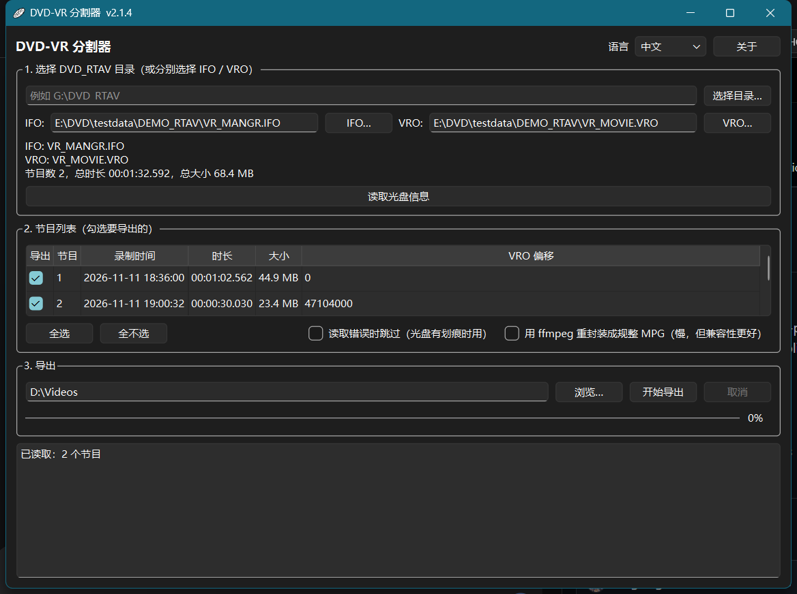 | 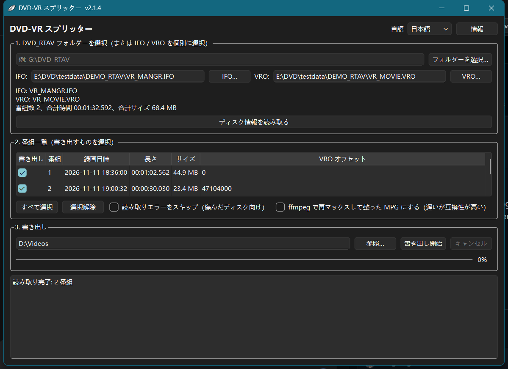 | 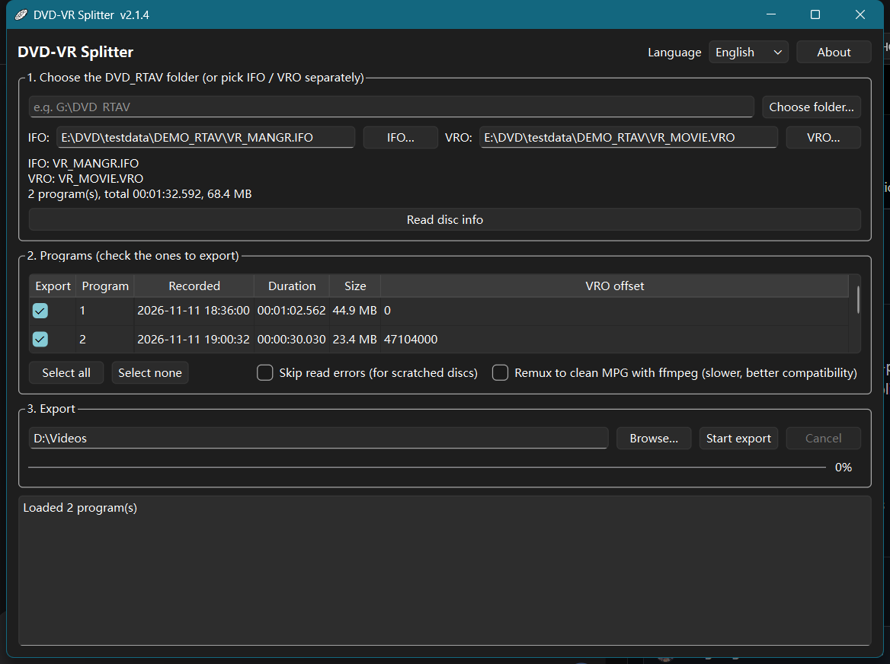 |
| 关于（仓库 + 头像） | 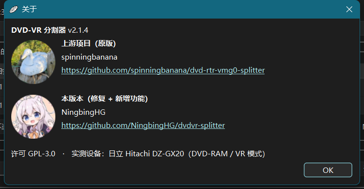 | 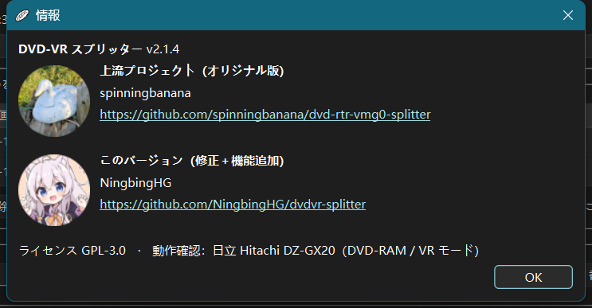 | 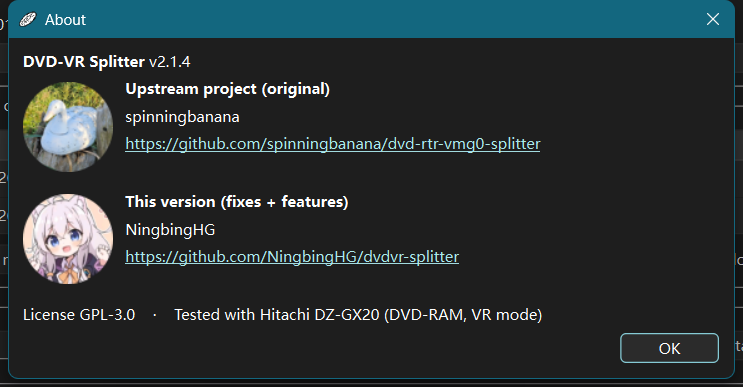 |
| 输入/输出同盘提醒 | 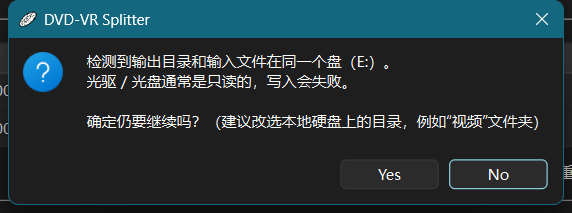 | 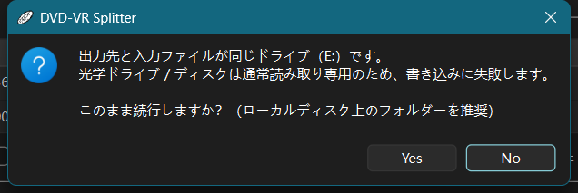 | 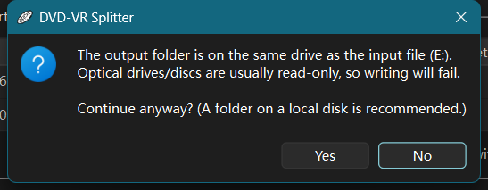 |
| 导出完成 | 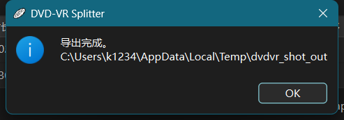 | 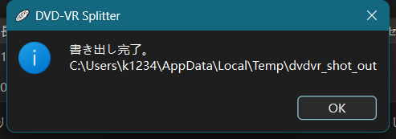 | 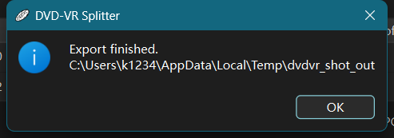 |
| 输出目录不可写 | 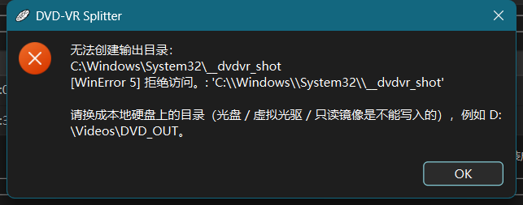 | 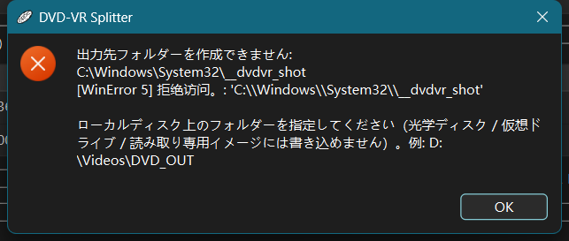 | 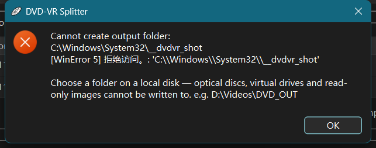 |